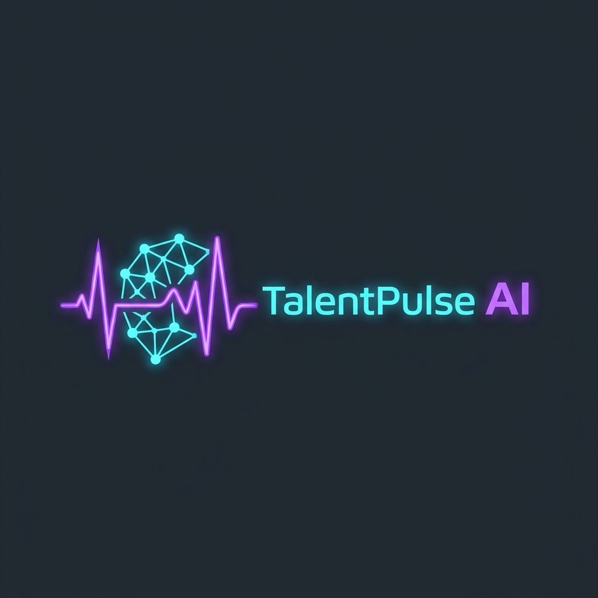

<div align="center">



# TalentPulse AI
### Autonomous Hiring Intelligence & Candidate Evaluation Engine

[](https://opensource.org/licenses/MIT)
[](https://developer.mozilla.org/en-US/docs/Web/JavaScript)
[](https://python.org)
[](#design--ux-philosophy)
[](#)

*Transforming unstructured resumes into calibrated, multi-dimensional candidate insights, tailored interview kits, and executive hiring analytics.*

[Live Demo](#quick-start) • [Why We Built This](#the-problem-why-we-built-talentpulse) • [Core Features](#features-at-a-glance) • [Architecture](#under-the-hood-system-architecture) • [Getting Started](#quick-start)

</div>

---

## 💡 The Problem: Why We Built TalentPulse

Technical recruiting in high-growth engineering and AI teams is fundamentally bottlenecked:

1. **Recruiter Burnout & Screen Fatigue:** Sourcing teams spend 20–30 hours each week skimming through hundreds of resumes. Keyword-based ATS filters either discard stellar non-traditional candidates or pass through buzzword-stuffed profiles.
2. **The "Uncalibrated Interview" Trap:** Hiring managers often step into technical screens without a tailored plan, re-asking basic trivia instead of probing genuine project claims and architectural trade-offs.
3. **The Communication Black Hole:** Candidates spend hours preparing applications only to receive impersonal form rejections—or worse, complete radio silence.
4. **Blind Spot at the Executive Level:** Leadership rarely has real-time visibility into pipeline drop-off rates, time-to-hire savings, or talent scarcity heatmaps.

**TalentPulse AI was designed to fix this.** It acts as an autonomous intelligence layer across the entire recruitment lifecycle—from architecting calibrated job requisitions to scoring candidate resumes against real-world competencies and generating custom interview playbooks.

---

## 🚀 Features at a Glance

### 1. 🎯 For Technical Recruiters
- **AI Job Architect:** Convert a casual 1-sentence prompt (*"Staff Distributed AI Infra Engineer, PyTorch, vLLM, hybrid SF"*) into a production-grade requisition with calibrated rubric weights, salary bands, and responsibilities.
- **Neural Resume Parser & Matcher:** Upload PDFs, DOCX, or raw text. The engine parses work history, projects, and impact metrics, calculating weighted dimensional match scores from 0 to 100.
- **Dynamic 7-Stage Pipeline:** Manage applicants across `Sourced` → `Screening` → `AI Evaluated` → `HM Review` → `Interview` → `Offer` → `Hired` with HTML5 drag-and-drop and instant Table/Kanban toggling.
- **AI Outreach Copilot:** One-click generation of personalized interview invitations, offer letters, or constructive, empathetic feedback citing actual project achievements.

### 2. 👥 For Hiring Managers
- **Side-by-Side Candidate Comparison Matrix:** Evaluate 2–3 shortlisted candidates head-to-head across dimensional radar bars, trade-offs, and an autonomous AI synthesis verdict.
- **Tailored 3-Round Interview Kits:** Synthesizes custom questions for **Technical Deep-Dives**, **System Architecture Scenarios**, and **Behavioral Collaboration**, complete with *"Why Ask This"* context and *"Signals to Look For"* rubric guidelines.
- **Scorecard Submission Workflow:** Submit 1–5 star ratings for domain expertise and communication, capture written debrief notes, and advance candidates directly into the interview loop.

### 3. 📊 For Talent Executives & People Ops
- **Real-Time ROI & Velocity Metrics:** Track measurable business value:
  - **-66.2% Time-to-Hire Reduction** (from 42.0 to 14.2 days).
  - **248 Recruiter Hours Saved / month** via automated initial screening.
  - **$64,000 YTD Agency Spend Avoidance** by building strong internal talent pipelines.
  - **68.4% Screen-to-Offer Conversion Rate** (vs. 24.1% industry average).
- **Interactive Pipeline Conversion Funnel:** Visualize candidate flow, volume, and drop-off ratios at each milestone.
- **Talent Scarcity Heatmap:** Compare open requisition skill requirements against available applicant pool supply.
- **Certified Fair Hiring Audit:** Active demographic blindness guardrails ensure PII, age, and school pedigree are strictly decoupled from scoring criteria.

### 4. 🌐 For Candidates (Career Portal)
- Clean, transparent career listings with verified compensation bands and role missions.
- **Instant AI Resume Readiness Checker:** Applicants can upload or paste their resume to get a confidential, real-time match preview and customized study tips before submitting their application.

---

## 🧠 Multi-Dimensional Scoring Engine

Rather than relying on naive regex or simplistic keyword tallies, TalentPulse scores candidates across four distinct weighted pillars calibrated per role:

$$\text{Overall Fit Score} = \frac{W_{\text{tech}} \cdot S_{\text{tech}} + W_{\text{arch}} \cdot S_{\text{arch}} + W_{\text{prob}} \cdot S_{\text{prob}} + W_{\text{cult}} \cdot S_{\text{cult}}}{W_{\text{total}}}$$

```
┌────────────────────────────────────────────────────────┐
│               Candidate Fit Pillars (0-100)            │
├─────────────────────────┬──────────────────────────────┤
│ 1. Technical Mastery    │ Core frameworks, kernels,    │
│                         │ language fluency & tools     │
├─────────────────────────┼──────────────────────────────┤
│ 2. Architecture & Scope │ Years of exp, distributed    │
│                         │ scale, microservices & SLAs  │
├─────────────────────────┼──────────────────────────────┤
│ 3. Problem Solving      │ Documented business impact,  │
│                         │ latency reductions, metrics  │
├─────────────────────────┼──────────────────────────────┤
│ 4. Culture & Velocity   │ Mentorship, RFC leadership,  │
│                         │ cross-functional teamwork    │
└─────────────────────────┴──────────────────────────────┘
```

---

## 📦 Standardized ATS JSON Schema Output

Every evaluation produces an exportable, standardized JSON payload ready for integration with existing ATS platforms (Workday, Greenhouse, Lever, Ashby):

```json
{
  "$schema": "https://talentpulse.ai/schemas/v3/candidate-evaluation.json",
  "candidateId": "cand-1",
  "candidateName": "Dr. Elena Rostova",
  "overallScore": 95,
  "matchTier": "Top 5% Strong Match",
  "recommendation": "Strong Hire",
  "dimensionBreakdown": {
    "technicalMastery": 98,
    "architectureScope": 94,
    "problemSolving": 96,
    "cultureLeadership": 90
  },
  "skillAudit": {
    "matchedRequired": ["Python", "PyTorch", "vLLM", "CUDA", "Triton", "Kubernetes", "Ray"],
    "missingRequired": [],
    "matchedPreferred": ["TensorRT-LLM", "FlashAttention", "FP8 Quantization"]
  },
  "confidenceScore": 0.94
}
```

---

## 🎨 Design & UX Philosophy

- **Enterprise Light Aesthetic:** Inspired by modern software tools like Linear, Stripe, and Notion—built with clean off-white canvases (`#f8fafc`), pure white cards (`#ffffff`), crisp slate borders (`#e2e8f0`), and high-contrast typography (`#0f172a`).
- **Zero Bloat, Zero Dependencies:** Built entirely with modern standard HTML5, CSS3 Custom Properties, and modular ES6 JavaScript. No 500MB `node_modules` folder, no complex bundler configurations, and instantaneous sub-millisecond render cycles.
- **Accessibility & Responsiveness:** Fully fluid layout adapting seamlessly from 4K ultrawide monitors to compact laptop screens.

---

## 🛠️ Project Structure

```
talentpulse-ai/
├── assets/
│   └── logo.jpg               # TalentPulse AI official brand icon
├── styles/
│   ├── variables.css          # Design tokens, color system, and typography tokens
│   ├── main.css               # App shell, sticky top navbar, and role switcher banner
│   ├── components.css         # Buttons, modals, score rings, badges, and dropzones
│   ├── pipeline.css           # 7-stage interactive Kanban board and candidate cards
│   ├── evaluation.css         # Scorecard drawer, interview kits, and JSON viewers
│   └── dashboard.css          # Executive KPI cards, funnel charts, and skills matrix
├── js/
│   ├── seedData.js            # Rich, realistic pre-populated jobs and candidate pool
│   ├── state.js               # Reactive application store & role-permission manager
│   ├── aiEngine.js            # Semantic evaluation engine & outreach copy drafter
│   ├── app.js                 # App root orchestrator, routing, and toast system
│   └── components/
│       ├── navbar.js          # Sticky header navigation & role selector
│       ├── jobsView.js        # Requisitions catalog & AI Job Architect modal
│       ├── pipelineView.js    # Drag-and-drop recruiter pipeline workspace
│       ├── candidateDetailModal.js # Scorecard drawer & interview kit viewer
│       ├── hiringManagerView.js    # Comparison matrix & scorecard decision hub
│       ├── executiveDashboard.js   # Leadership analytics & hiring ROI dashboard
│       └── candidatePortalView.js  # Candidate application & resume preview portal
├── index.html                 # Single-Page Application entry point
├── server.py                  # Multi-threaded local Python web server
└── README.md                  # Comprehensive documentation
```

---

## ⚡ Quick Start

### Prerequisites
- Python 3.8+ (no external pip packages needed—uses standard library)
- Any modern web browser (Chrome, Edge, Firefox, Safari)

### 1. Clone the Repository
```bash
git clone https://github.com/SubhadeepBhadra/talentpulse-ai.git
cd talentpulse-ai
```

### 2. Start the Local Server
```bash
python server.py
```

### 3. Open in Browser
Visit **[http://localhost:5173](http://localhost:5173)** in your browser!

*(Alternatively, you can open `index.html` directly in any web browser without running a server.)*

---

## 🧪 Testing the User Flows

Once inside the app, use the **Role Switcher** in the top navigation bar to explore the different perspectives:

1. **Recruiter View (Sarah Jenkins):**
   - Click **"+ Post Job"** and try typing a brief prompt to watch the AI Architect synthesize a complete job listing.
   - Click **"Evaluate Resume"** to upload a file or click one of the quick-fill sample presets to run the real-time AI evaluation.
   - Drag candidate cards across pipeline stages or toggle between **Kanban** and **Table** view.
2. **Hiring Manager View (Alex Rivera):**
   - Head to the **HM Review** tab to inspect the **Side-by-Side Candidate Comparison Matrix**.
   - Click **"Submit Decision"** on any candidate to grade them on the interview rubric.
3. **Executive Dashboard (Elena Vance):**
   - Click **"Executive Dashboard"** to see real-time ROI metrics, conversion funnels, and fair hiring bias audit reports.
4. **Candidate Portal (Jordan Lee):**
   - Click **"Candidate Portal"** to view open roles and test the **"Preview Resume Match"** tool before applying.

---

## 📄 License

Distributed under the **MIT License**. See `LICENSE` for more information.

---

<div align="center">

Made with passion by [Subhadeep Bhadra](https://github.com/SubhadeepBhadra)

*Contributions, issues, and feature requests are welcome!*

</div>
